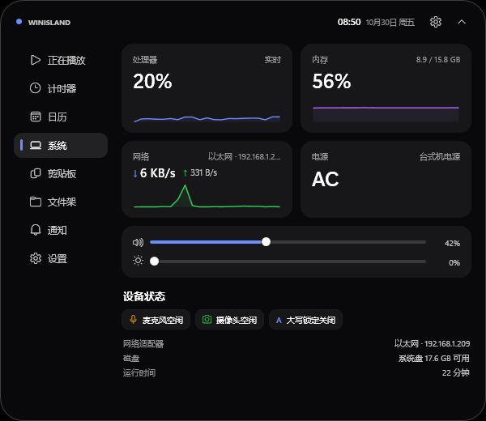

# WinIsland · Windows 灵动岛 / Dynamic Island for Windows

<p align="center">
  <a href="https://github.com/chenwei1993/Winisland/releases/latest"></a>
  <a href="https://github.com/chenwei1993/Winisland/releases"></a>
  <a href="https://github.com/chenwei1993/Winisland/blob/master/LICENSE"></a>
  
</p>

一款为 Windows 10/11 打造的「灵动岛」（Dynamic Island / 顶部刘海）桌面小组件：悬浮在屏幕顶部中央，把媒体、计时器、系统状态、剪贴板、文件与通知都收进一颗黑色药丸里。

**WinIsland** is a **Dynamic Island for Windows 10/11**, built with WPF and .NET. It brings media controls, Bluetooth earbuds, AI usage (DeepSeek / OpenCode Go / OpenDesign), system monitor, clipboard history, file shelf and notifications into one lightweight top-of-screen notch.

> 在线主页与截图：[chenwei1993.github.io/Winisland](https://chenwei1993.github.io/Winisland/)

> 关键词 / Keywords：Windows 灵动岛、Windows 11 刘海、Dynamic Island for Windows、WPF 桌面组件、蓝牙耳机控制、AI 用量监控、DeepSeek 余额、OpenCode Go 额度、OpenDesign 额度、剪贴板管理、系统监控。Windows desktop widget, Bluetooth earbuds, AI usage monitor, clipboard manager, system monitor.




<p align="center"></p>
<p align="center"></p>

## 功能

**岛上常驻**

- 时间、日期、电量与充电状态
- 麦克风 / 摄像头使用指示、大写锁定指示
- 正在播放的媒体：标题、歌手、封面、进度、播放/暂停、上一首/下一首、音量
- 打开新应用时显示应用图标、名称与窗口标题；切换已运行应用默认不提醒，可在设置中开启
- 镜像 Windows 通知中心：微信、邮件、安全中心等应用消息，带应用图标与正文
- 窗口避让：平时保持显示，岛下方有应用窗口时自动收成顶部细线，回到桌面再展开，默认开启（与贴边自动隐藏二选一）
- 贴边自动隐藏：可选模式，平时始终收成顶部细线，鼠标移到顶部中央或出现事件时显示
- 倒计时 / 秒表：剩余时间、进度环，计时结束自动提醒
- 定时提醒：设置目标时间或快捷 5/15/30/60 分钟；支持每天 / 工作日 / 每周重复。到点后常驻岛上，带橙色脉冲光晕、铃声摆动和轻微晃动来强提醒，点击「关闭提醒」才会消失；重复提醒关闭后会自动排到下一次，重启后仍会补提醒
- 音量、亮度实时 HUD（系统音量变化、DDC/CI 显示器亮度变化都会触发）
- 系统页可直接切换扬声器 / 耳机 / HDMI 等播放设备，默认设备变化时自动刷新
- 多品牌蓝牙耳机：OPPO / OnePlus / realme、华为、荣耀、小米 / Redmi、vivo / iQOO、索尼、漫步者、森海塞尔、三星、Google、Bose、Nothing 等；显示连接状态、电量、降噪、EQ、空间音效与型号支持的开关
- 多设备切换：在耳机卡片里选择已配对的不同品牌耳机，自动切换当前控制设备
- 品牌高级设置：耳机上报的自动关机、触控按键分配、环境声级别等选项自动生成列表 / 滑杆；支持查找耳机（响铃）与贴合度检测
- AI 用量上岛：按平台顺序显示第一个有数据的平台；DeepSeek 余额 / 今日消耗、OpenCode Go 的 5 小时 / 每周 / 每月额度、OpenDesign 的 5 小时 / 每周额度与钱包；阈值提醒，可常驻小徽标
- 字体大小：设置里可选小 / 中 / 大，岛上与展开面板即时生效
- 自动更新：启动时和每 6 小时检查 GitHub Releases，发现新版本会提示，设置里可一键下载并重启安装；国内网络会自动测速并选择最快的加速镜像，支持断点续传，下载后校验文件版本
- AI 用量配置窗口：按平台单独管理 Key、启用开关和告警阈值，可调整平台显示顺序与刷新间隔；OpenDesign 支持 Control Key 或浏览器 Cookie，并可填写工作区 ID；用量页只显示已启用的平台，新增平台只需加一行配置
- 复制文本 / 图片 / 文件时的剪贴板提示
- 通知横幅：带图标与颜色分级（info / success / warning / error / timer）
- 拖入文件时自动展开为放置区，松手加入文件架

**展开面板**

| 页面 | 能力 |
| --- | --- |
| 正在播放 | 封面、曲目信息、可拖动进度条（紧凑态也可拖动）、播放控制、音量 |
| 计时器 | 1/3/5/10/25 分钟预设、暂停/继续、+1 分钟、秒表；定时提醒（每天 / 工作日 / 每周重复，到点常驻，关闭后自动排下一次） |
| 日历 | 月视图、今日高亮、月份切换、实时时钟与周数 |
| 系统 | CPU / 内存 / 网络速率实时曲线，电池、音量、亮度、播放设备切换、多品牌耳机电量 / 降噪 / EQ / 空间音效、网络适配器、磁盘、运行时长，麦克风/摄像头/大写锁定状态 |
| 用量 | 仅显示已启用的平台，顺序可自定义；DeepSeek 余额与今日消耗、OpenCode Go 的 5 小时 / 每周 / 每月额度、OpenDesign 的 5 小时 / 每周额度与钱包，阈值颜色、重置倒计时、手动刷新；Key 本机加密保存 |
| 剪贴板 | 最近 30 条文本 / 文件、4 条图片（压缩后保存）、点击回填、暂停记录、清空 |
| 文件架 | 拖入/拖出文件与文件夹、缩略图、打开、移除，重启后保留 |
| 通知 | 外部程序推送的通知中心，未读角标、全部清除 |
| 设置 | 开机自启、始终置顶、全屏时隐藏、通知音效、系统通知、窗口避让、贴边自动隐藏、切换应用提醒、剪贴板开关、字体大小、AI 用量（独立配置窗口）、快捷键与 API 说明、退出 |

**系统集成**

- 打开新应用时实时上岛，显示应用图标、名称和窗口标题；切换已运行的应用默认不提醒，可在设置中开启
- 窗口避让默认开启：岛下方有应用窗口时自动收成顶部细线，回到桌面自动展开；也可在设置里改为贴边自动隐藏或始终显示
- 屏幕顶部居中、无边框、无外层窗口或阴影，只有岛本身可见
- 单击展开，点击岛外 / `Esc` / 再次按快捷键收起
- 全局快捷键 `Ctrl + Alt + I` 展开 / 收起
- 托盘图标：展开 / 收起、设置、测试通知、退出
- 全屏应用（视频、游戏）自动隐藏
- 单实例运行；再次启动会把命令转发给已运行的岛
- 媒体信息通过 Windows SMTC 获取，支持系统里所有媒体应用
- 多品牌耳机通过各自厂商的 RFCOMM / GATT 控制通道读取电量与控制降噪，需要耳机先在系统蓝牙中连接

## 快速开始

### 直接运行（不需要安装 .NET）

项目里已经生成好一个 **win-x64 单文件自包含版本**：

```
dist\WinIsland.exe
```

双击即可运行，不需要安装 .NET 运行时，也不需要设置 `DOTNET_ROOT`。当前发布的是**未压缩**单文件（约 173 MB），体积大一些，但内存占用明显更低。

重新生成：

```powershell
./publish.ps1
```

如果更在意体积，可以生成压缩版（约 73 MB），代价是运行时需要解压程序集，私有内存大约翻倍：

```powershell
./publish.ps1 -Compressed
```

脚本默认打包 `win-x64`；ARM64 机器把脚本里的 `-r win-x64` 改成 `-r win-arm64` 即可。

### 从源码运行

环境：Windows 10 2004+ / Windows 11、.NET 10 SDK、WPF。

```powershell
dotnet build
dotnet run
```

也可以直接用 Rider 打开 `WinIsland.sln` 运行。

> 注意：`bin` 目录里的是框架依赖构建，如果机器上的 .NET 只安装在用户目录，直接双击 `bin\...\WinIsland.exe` 可能找不到运行时，请使用 `dotnet run` / Rider，或者直接运行上面的 `dist\WinIsland.exe`。开启「开机自启」时，程序会根据当前是框架依赖还是自包含构建，自动选择 `dotnet.exe WinIsland.dll` 或 exe 本身。

发布自包含版本（低内存的未压缩方式）：

```powershell
dotnet publish .\WinIsland.csproj -c Release -r win-x64 --self-contained true `
  -p:PublishSingleFile=true -p:IncludeNativeLibrariesForSelfExtract=true `
  -p:EnableCompressionInSingleFile=false -o .\dist
```

## 内存占用

项目针对常驻使用做过以下优化：

- 贴边模式下只保留 120×4 的细线，展开面板按需创建，收起时从可视化树卸载
- 剪贴板图片改为压缩 PNG 保存，最多保留 4 张，超宽图片先缩到 1920 px
- 专辑封面按 224 px 解码，避免为每次媒体切换保留大位图
- 单文件默认不压缩，避免 .NET 在内存中保存解压后的运行时副本
- 只在展开 / 收起动画期间挂接 WPF 渲染循环，静止时不再每秒空转 60 次
- 从展开面板收回到细线后，在空闲时做一次 GC，减少长期切换面板留下的对象

在这台机器上的实测（`PrivateMemorySize64`，任务管理器里的「提交大小」）：

| 状态 | 私有内存 | 工作集 |
| --- | --- | --- |
| 贴边细线、刚启动 | 约 78–100 MB | 约 163–188 MB |
| 展开「系统」页 | 约 135–141 MB | 约 236–246 MB |
| 展开后收回细线 | 约 127–131 MB | 约 231–234 MB |
| 反复切换完全部面板后 | 约 160 MB | 约 275 MB |
| 旧的压缩单文件版本 | 约 160–197 MB | 约 321–367 MB |

工作集包含可被系统回收的缓存页，持续增长时应以私有内存为准。启用耳机控制后，蓝牙设备枚举与 RFCOMM / GATT 会话通常会让私有内存再增加约 5–15 MB。如果还需要进一步压低，下一步可以把托盘从 WinForms `NotifyIcon` 换成原生 `Shell_NotifyIcon`，去掉 WinForms / System.Drawing 依赖，预计还能省十几 MB。

## 通知 API

### 命令行

```powershell
# 推送通知
WinIsland.exe --notify "构建完成" "所有测试已通过" "CI"

# 开始一个 5 分钟计时（支持小数分钟）
WinIsland.exe --timer 5 "泡茶"

# 把文件放进文件架
WinIsland.exe --shelf "C:\Reports\weekly.pdf" "C:\Images\cover.png"

# 在岛上显示任意任务的进度
WinIsland.exe --progress 42 "正在下载更新" "Windows 11 ISO · 1.2 / 2.8 GB"

# 展开 / 收起
WinIsland.exe --show
WinIsland.exe --collapse
```

不带参数再次启动，会展开已经运行的岛。

### 命名管道

管道名称：`\\.\pipe\WinIsland`。每行一个 JSON 对象或 `标题|内容` 纯文本。

```json
{"action":"notify","title":"部署完成","message":"生产环境已更新","app":"Deploy","kind":"success","seconds":8}
{"action":"timer","minutes":25,"title":"专注"}
{"action":"shelf","files":["C:\\Reports\\weekly.pdf"]}
{"action":"progress","title":"正在下载","message":"1.2 / 2.8 GB","progress":42,"seconds":8}
{"action":"usage","provider":"my-cli","name":"我的 CLI","label":"5 小时","used":41,"limit":50,"resetAt":"2026-11-20T20:00:00Z"}
{"action":"show"}
{"action":"collapse"}
```

`kind` 可选：`info`、`success`、`warning`、`error`、`timer`。`seconds` 控制横幅停留时长（1.5–30 秒）。`progress` 可以传 0–1 或 0–100，脚本连续推送即可得到实时进度条。

`usage` 用于让其它 CLI / 插件把额度推上岛：`percent`（0–100，或 0–1 小数）与 `used` + `limit` 二选一，`resetAt` 为 ISO 时间，`balance` + `currency` 可显示余额。同名 `provider` 会更新同一张卡片，最多保留 1 个窗口，重复推送同 `resetAt` 只提醒一次。

附带的 PowerShell 示例：

```powershell
./samples/Notify-Island.ps1 -Title "构建完成" -Message "全部 128 个测试通过" -App "CI" -Kind success
./samples/Usage-Island.ps1 -Provider "opencode-go" -Name "OpenCode Go" -Label "5 小时" -Percent 62 -ResetAt "2026-11-20T20:00:00Z"
```

## 数据与隐私

- 设置：`%AppData%\WinIsland\settings.json`
- 文件架：`%AppData%\WinIsland\shelf.json`
- 定时提醒：`%AppData%\WinIsland\reminders.json`
- 耳机 LE Audio 记录：`%AppData%\WinIsland\le-audio-devices.json`
- AI 用量 Key：`%AppData%\WinIsland\usage-secrets.json`（Windows DPAPI 加密，仅当前用户可解密）
- AI 用量状态：`%AppData%\WinIsland\usage-state.json`（提醒去重、今日消耗估算）
- 崩溃日志：`%AppData%\WinIsland\crash.log`
- 调试日志：设置环境变量 `WINISLAND_DEBUG=1` 后写入 `debug.log`

剪贴板历史只保存在内存中，退出即清除；可在设置或剪贴板页随时暂停记录。

## 项目结构

```
App.xaml(.cs)            启动、单实例、托盘、命令行
MainWindow.xaml(.cs)     岛的形态、动画、交互与面板切换
MainViewModel.cs         绑定用的聚合状态
Services/                媒体、音量、亮度、电源、系统监控、剪贴板、计时、文件架、通知管道、AI 用量
Panes/                   展开面板的 9 个页面
UsageSettingsWindow      独立的 AI 用量配置窗口（按平台一行）
Controls/                RingProgress / Sparkline 自绘控件
Interop/                 Win32、Core Audio、DDC/CI、全局鼠标钩子
Vendor/EncoDeck.*        多品牌耳机协议、蓝牙传输与设备状态引擎（GPL-3.0）
Themes/Theme.xaml        配色、字体、按钮 / 滑杆 / 开关 / 滚动条样式
samples/                 PowerShell 通知示例
publish.ps1              生成免安装单文件 exe
dist/                    生成好的 WinIsland.exe
```

## 已知限制

- 媒体进度、封面、播放控制依赖源应用的 SMTC 实现。Chrome 等浏览器对进度和暂停的回报并不总是及时。
- 进度跳转同样依赖播放器实现：QQ音乐等少数播放器会返回成功但忽略定位请求，此时岛上会提示「当前播放器不支持进度跳转」；Spotify、Windows Media Player 等支持 SMTC 定位的播放器可以正常快进/快退。
- 系统通知镜像需要「允许 WinIsland 访问通知」：首次启动会请求授权，若拒绝可在 Windows 设置 → 隐私和安全性 → 通知中重新开启。
- 亮度调节依赖显示器 DDC/CI；不支持 DDC 的显示器会显示为 0% 或无法调节。
- 岛固定在主屏顶部中央；暂不支持拖拽位置、多屏选择与皮肤换色。
- 剪贴板会记录复制内容，敏感环境请关闭记录。
- 全屏检测基于前台窗口覆盖整个屏幕，极少数无边框窗口可能被误判。
- 耳机必须先在系统蓝牙中连接；实际可用的降噪 / EQ / 空间音效 / 游戏模式取决于型号、固件与厂商控制协议。
- 多品牌支持来自 EncoDeck 的型号能力库，部分型号仍属于协议实现而非逐项真机验证；遇到不生效的功能可以在设置里关闭对应控制。
- 耳机同一时间通常只允许一个厂商控制客户端；运行官方 HeyMelody、EncoDeck 或品牌官方客户端时可能争用控制通道。
- 耳机协议是社区逆向结果，固件更新后可能失效；连接失败不会影响岛的其他功能。
- DeepSeek 官方只有余额接口，没有分时段用量接口；岛上的「今日消耗」由余额快照差估算，充值和接口延迟会使数字短期不精确。
- OpenCode Go 的百分比来自官方 usage 接口，按 5 小时 / 每周 / 每月三个窗口返回；额度规则如有调整以服务端为准。
- OpenDesign 的额度接口未公开文档，需要 Control Key（`vela_ctrl_…`）或浏览器 Cookie；推理 API Key（`sk-amr_…`）不能查询额度。Cookie 会过期，重新登录后需要更新；接口结构变化时可能需要适配。

## 开源许可

WinIsland 以 **GPL-3.0** 发布，因为包含了
[EncoDeck](https://github.com/TIANLI0/EncoDeck) 的多品牌耳机协议与控制引擎。
完整条款见 [`LICENSE`](LICENSE)，第三方归属与来源见
[`THIRD_PARTY_NOTICES.md`](THIRD_PARTY_NOTICES.md)。

本项目与 OPPO、OnePlus、realme、华为、荣耀、小米、vivo、索尼、漫步者、
森海塞尔、三星、Google、Bose、Nothing 等品牌及 Microsoft 没有官方关联。
