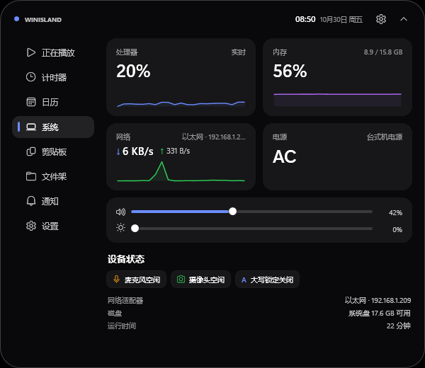

# WinIsland · Windows 灵动岛

一款为 Windows 打造的「灵动岛」：悬浮在屏幕顶部中央，把媒体、计时器、系统状态、剪贴板、文件与通知都收进一颗黑色药丸里。




<p align="center"></p>
<p align="center"></p>

## 功能

**岛上常驻**

- 时间、日期、电量与充电状态
- 麦克风 / 摄像头使用指示、大写锁定指示
- 正在播放的媒体：标题、歌手、封面、进度、播放/暂停、上一首/下一首、音量
- 打开新应用时显示应用图标、名称与窗口标题；切换已运行应用默认不提醒，可在设置中开启
- 镜像 Windows 通知中心：微信、邮件、安全中心等应用消息，带应用图标与正文
- 窗口避让：平时保持显示，岛下方有应用窗口时自动收成顶部细线，回到桌面再展开，默认开启（与贴边自动隐藏二选一）
- 贴边自动隐藏：可选模式，平时始终收成顶部细线，鼠标移到顶部中央或出现事件时显示
- 倒计时 / 秒表：剩余时间、进度环，计时结束自动提醒
- 音量、亮度实时 HUD（系统音量变化、DDC/CI 显示器亮度变化都会触发）
- 系统页可直接切换扬声器 / 耳机 / HDMI 等播放设备，默认设备变化时自动刷新
- 复制文本 / 图片 / 文件时的剪贴板提示
- 通知横幅：带图标与颜色分级（info / success / warning / error / timer）
- 拖入文件时自动展开为放置区，松手加入文件架

**展开面板**

| 页面 | 能力 |
| --- | --- |
| 正在播放 | 封面、曲目信息、可拖动进度条（紧凑态也可拖动）、播放控制、音量 |
| 计时器 | 1/3/5/10/25 分钟预设、暂停/继续、+1 分钟、秒表 |
| 日历 | 月视图、今日高亮、月份切换、实时时钟与周数 |
| 系统 | CPU / 内存 / 网络速率实时曲线，电池、音量、亮度、播放设备切换、网络适配器、磁盘、运行时长，麦克风/摄像头/大写锁定状态 |
| 剪贴板 | 最近 30 条文本 / 文件、4 条图片（压缩后保存）、点击回填、暂停记录、清空 |
| 文件架 | 拖入/拖出文件与文件夹、缩略图、打开、移除，重启后保留 |
| 通知 | 外部程序推送的通知中心，未读角标、全部清除 |
| 设置 | 开机自启、始终置顶、全屏时隐藏、通知音效、系统通知、窗口避让、贴边自动隐藏、切换应用提醒、剪贴板开关、快捷键与 API 说明、退出 |

**系统集成**

- 打开新应用时实时上岛，显示应用图标、名称和窗口标题；切换已运行的应用默认不提醒，可在设置中开启
- 窗口避让默认开启：岛下方有应用窗口时自动收成顶部细线，回到桌面自动展开；也可在设置里改为贴边自动隐藏或始终显示
- 屏幕顶部居中、无边框、无外层窗口或阴影，只有岛本身可见
- 单击展开，点击岛外 / `Esc` / 再次按快捷键收起
- 全局快捷键 `Ctrl + Alt + I` 展开 / 收起
- 托盘图标：展开 / 收起、设置、测试通知、退出
- 全屏应用（视频、游戏）自动隐藏
- 单实例运行；再次启动会把命令转发给已运行的岛
- 媒体信息通过 Windows SMTC 获取，支持系统里所有媒体应用

## 快速开始

### 直接运行（不需要安装 .NET）

项目里已经生成好一个 **win-x64 单文件自包含版本**：

```
dist\WinIsland.exe
```

双击即可运行，不需要安装 .NET 运行时，也不需要设置 `DOTNET_ROOT`。当前发布的是**未压缩**单文件（约 173 MB），体积大一些，但内存占用明显更低。

重新生成：

```powershell
./publish.ps1
```

如果更在意体积，可以生成压缩版（约 73 MB），代价是运行时需要解压程序集，私有内存大约翻倍：

```powershell
./publish.ps1 -Compressed
```

脚本默认打包 `win-x64`；ARM64 机器把脚本里的 `-r win-x64` 改成 `-r win-arm64` 即可。

### 从源码运行

环境：Windows 10 2004+ / Windows 11、.NET 10 SDK、WPF。

```powershell
dotnet build
dotnet run
```

也可以直接用 Rider 打开 `WinIsland.sln` 运行。

> 注意：`bin` 目录里的是框架依赖构建，如果机器上的 .NET 只安装在用户目录，直接双击 `bin\...\WinIsland.exe` 可能找不到运行时，请使用 `dotnet run` / Rider，或者直接运行上面的 `dist\WinIsland.exe`。开启「开机自启」时，程序会根据当前是框架依赖还是自包含构建，自动选择 `dotnet.exe WinIsland.dll` 或 exe 本身。

发布自包含版本（低内存的未压缩方式）：

```powershell
dotnet publish .\WinIsland.csproj -c Release -r win-x64 --self-contained true `
  -p:PublishSingleFile=true -p:IncludeNativeLibrariesForSelfExtract=true `
  -p:EnableCompressionInSingleFile=false -o .\dist
```

## 内存占用

项目针对常驻使用做过以下优化：

- 贴边模式下只保留 120×4 的细线，展开面板按需创建，收起时从可视化树卸载
- 剪贴板图片改为压缩 PNG 保存，最多保留 4 张，超宽图片先缩到 1920 px
- 专辑封面按 224 px 解码，避免为每次媒体切换保留大位图
- 单文件默认不压缩，避免 .NET 在内存中保存解压后的运行时副本
- 只在展开 / 收起动画期间挂接 WPF 渲染循环，静止时不再每秒空转 60 次
- 从展开面板收回到细线后，在空闲时做一次 GC，减少长期切换面板留下的对象

在这台机器上的实测（`PrivateMemorySize64`，任务管理器里的「提交大小」）：

| 状态 | 私有内存 | 工作集 |
| --- | --- | --- |
| 贴边细线、刚启动 | 约 78–100 MB | 约 163–188 MB |
| 展开「系统」页 | 约 135–141 MB | 约 236–246 MB |
| 展开后收回细线 | 约 127–131 MB | 约 231–234 MB |
| 反复切换完全部面板后 | 约 160 MB | 约 275 MB |
| 旧的压缩单文件版本 | 约 160–197 MB | 约 321–367 MB |

工作集包含可被系统回收的缓存页，持续增长时应以私有内存为准。如果还需要进一步压低，下一步可以把托盘从 WinForms `NotifyIcon` 换成原生 `Shell_NotifyIcon`，去掉 WinForms / System.Drawing 依赖，预计还能省十几 MB。

## 通知 API

### 命令行

```powershell
# 推送通知
WinIsland.exe --notify "构建完成" "所有测试已通过" "CI"

# 开始一个 5 分钟计时（支持小数分钟）
WinIsland.exe --timer 5 "泡茶"

# 把文件放进文件架
WinIsland.exe --shelf "C:\Reports\weekly.pdf" "C:\Images\cover.png"

# 在岛上显示任意任务的进度
WinIsland.exe --progress 42 "正在下载更新" "Windows 11 ISO · 1.2 / 2.8 GB"

# 展开 / 收起
WinIsland.exe --show
WinIsland.exe --collapse
```

不带参数再次启动，会展开已经运行的岛。

### 命名管道

管道名称：`\\.\pipe\WinIsland`。每行一个 JSON 对象或 `标题|内容` 纯文本。

```json
{"action":"notify","title":"部署完成","message":"生产环境已更新","app":"Deploy","kind":"success","seconds":8}
{"action":"timer","minutes":25,"title":"专注"}
{"action":"shelf","files":["C:\\Reports\\weekly.pdf"]}
{"action":"progress","title":"正在下载","message":"1.2 / 2.8 GB","progress":42,"seconds":8}
{"action":"show"}
{"action":"collapse"}
```

`kind` 可选：`info`、`success`、`warning`、`error`、`timer`。`seconds` 控制横幅停留时长（1.5–30 秒）。`progress` 可以传 0–1 或 0–100，脚本连续推送即可得到实时进度条。

附带的 PowerShell 示例：

```powershell
./samples/Notify-Island.ps1 -Title "构建完成" -Message "全部 128 个测试通过" -App "CI" -Kind success
```

## 数据与隐私

- 设置：`%AppData%\WinIsland\settings.json`
- 文件架：`%AppData%\WinIsland\shelf.json`
- 崩溃日志：`%AppData%\WinIsland\crash.log`
- 调试日志：设置环境变量 `WINISLAND_DEBUG=1` 后写入 `debug.log`

剪贴板历史只保存在内存中，退出即清除；可在设置或剪贴板页随时暂停记录。

## 项目结构

```
App.xaml(.cs)            启动、单实例、托盘、命令行
MainWindow.xaml(.cs)     岛的形态、动画、交互与面板切换
MainViewModel.cs         绑定用的聚合状态
Services/                媒体、音量、亮度、电源、系统监控、剪贴板、计时、文件架、通知管道
Panes/                   展开面板的 8 个页面
Controls/                RingProgress / Sparkline 自绘控件
Interop/                 Win32、Core Audio、DDC/CI、全局鼠标钩子
Themes/Theme.xaml        配色、字体、按钮 / 滑杆 / 开关 / 滚动条样式
samples/                 PowerShell 通知示例
publish.ps1              生成免安装单文件 exe
dist/                    生成好的 WinIsland.exe
```

## 已知限制

- 媒体进度、封面、播放控制依赖源应用的 SMTC 实现。Chrome 等浏览器对进度和暂停的回报并不总是及时。
- 进度跳转同样依赖播放器实现：QQ音乐等少数播放器会返回成功但忽略定位请求，此时岛上会提示「当前播放器不支持进度跳转」；Spotify、Windows Media Player 等支持 SMTC 定位的播放器可以正常快进/快退。
- 系统通知镜像需要「允许 WinIsland 访问通知」：首次启动会请求授权，若拒绝可在 Windows 设置 → 隐私和安全性 → 通知中重新开启。
- 亮度调节依赖显示器 DDC/CI；不支持 DDC 的显示器会显示为 0% 或无法调节。
- 岛固定在主屏顶部中央；暂不支持拖拽位置、多屏选择与皮肤换色。
- 剪贴板会记录复制内容，敏感环境请关闭记录。
- 全屏检测基于前台窗口覆盖整个屏幕，极少数无边框窗口可能被误判。
